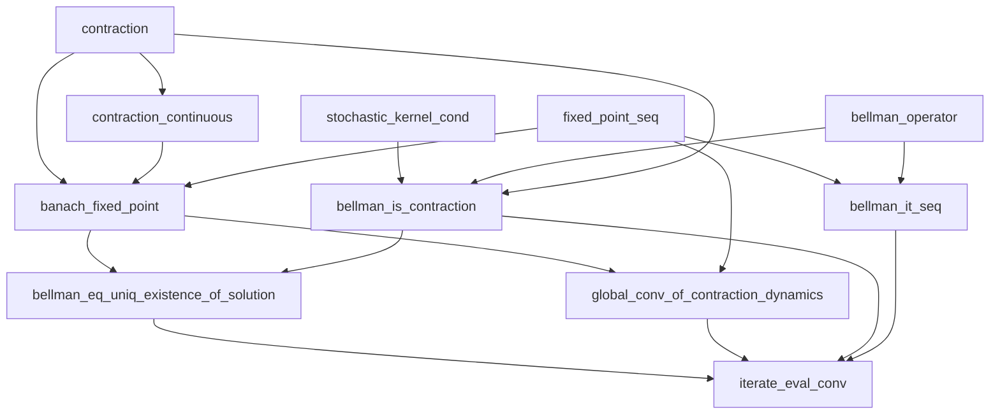

# Banach Fixed Points and Discounted Bellman Equations in Lean 4

A small, hand-written formalization of the Banach fixed-point theorem and its
application to finite-state discounted policy evaluation. The project connects
an abstract result in metric-space analysis to convergence of an iterative
algorithm in dynamic programming.

## Main results

| Result | Lean declaration | File |
| --- | --- | --- |
| A contraction is continuous | `contraction_continuous` | [Banach.lean](BanachBellman/Banach.lean) |
| A contraction on a nonempty complete metric space has a unique fixed point | `banach_fixed_point` | [Banach.lean](BanachBellman/Banach.lean) |
| The discounted Bellman operator is a contraction | `bellman_is_contraction` | [FiniteBellman.lean](BanachBellman/FiniteBellman.lean) |
| The Bellman equation has a unique solution | `bellman_eq_uniq_existence_of_solution` | [FiniteBellman.lean](BanachBellman/FiniteBellman.lean) |
| Contraction iterates satisfy a geometric error bound | `global_conv_of_contraction_dynamics` | [FiniteBellman.lean](BanachBellman/FiniteBellman.lean) |
| Policy-evaluation iterates converge from any initial value function | `iterate_eval_conv` | [FiniteBellman.lean](BanachBellman/FiniteBellman.lean) |

## Mathematical setting

For a map `f : X → X` on a nonempty complete metric space, assume

```text
d(f(x), f(y)) ≤ c · d(x, y),    0 ≤ c < 1.
```

The proof constructs `xₙ₊₁ = f(xₙ)`, bounds successive distances by a geometric
sequence, proves the iterates are Cauchy, and uses completeness to obtain a
limit. Continuity shows that the limit is a fixed point; the contraction
inequality establishes uniqueness. This proof does not invoke mathlib's
Banach fixed-point theorem.

For a finite state space `S`, a stochastic transition kernel `P`, a reward
function `r : S → ℝ`, and a discount factor `0 ≤ γ < 1`, define

```text
(TV)(s) = r(s) + γ · ∑ s', P(s, s') · V(s').
```

The finite function space `S → ℝ` carries the uniform metric. Nonnegative
transition probabilities and row sums equal to one give

```text
d(TV, TW) ≤ γ · d(V, W).
```

Applying the project's Banach theorem yields a unique solution `V*` to
`TV* = V*`. For any initial `V₀`, the iteration `Vₙ₊₁ = TVₙ` satisfies

```text
d(Vₙ, V*) ≤ γⁿ · d(V₀, V*),
```

and converges to `V*`. The geometric bound is proved in
`global_conv_of_contraction_dynamics` and used in `iterate_eval_conv`.

The application models a fixed policy through its transition kernel and
reward function. It does not include optimization over actions. This is the
discounted Bellman equation for policy evaluation, not the Bellman–Ford
shortest-path algorithm.

## Architecture

The code is organized as definitions → lemmas/proofs → theorems, with the
abstract fixed-point method supplying the finite Bellman application:

```text
BanachBellman.lean                         (imports both proof modules)
│
├── BanachBellman/Banach.lean
│   ├── Structure: contraction f c
│   │   ├── lipschitz: d(f(x), f(y)) ≤ c · d(x, y)
│   │   ├── lt_one: c < 1
│   │   └── nonneg: 0 ≤ c
│   ├── Lemma: contraction_continuous
│   ├── Definition: fixed_point_seq f x₀
│   └── Theorem: banach_fixed_point
│       ├── Geometric bounds on successive iterates and tails
│       ├── Cauchy sequence → limit by completeness
│       ├── Continuity → fixed point
│       └── Contraction inequality → uniqueness
│
└── BanachBellman/FiniteBellman.lean
    ├── Definition: stochastic_kernel_cond P
    ├── Definition: bellman_operator P r γ
    ├── Lemma: bellman_is_contraction
    ├── Theorem: bellman_eq_uniq_existence_of_solution
    ├── Theorem: global_conv_of_contraction_dynamics
    │   └── Geometric error bound for any contraction
    ├── Definition: bellman_it_seq P r γ V₀
    └── Theorem: iterate_eval_conv
        ├── Geometric error bound → distance tends to zero
        └── Uniqueness of limits
```

### Proof Dependencies

Arrows point from a prerequisite to the definition or result that uses it.
The diagram shows dependencies between project declarations; mathlib's
supporting results are omitted.



The fixed-point method branches into existence and uniqueness of the Bellman
solution and a general geometric error bound. The final convergence proof
combines these branches, using `γⁿ → 0` to show that the Bellman iterates
converge to the unique solution.

## Build and inspect

Install Lean using [elan](https://github.com/leanprover/elan), then run from the
repository root:

```sh
lake exe cache get
lake build
lake env lean scripts/CheckAxioms.lean
```

The `lean-toolchain` file selects **Lean 4.33.0-rc2**. The Lake configuration and
committed manifest pin mathlib to
`985d97018f12d5ac61a60f551da15d7a4b1e7ac1` and its corresponding dependencies.
The first command downloads precompiled mathlib artifacts; the second checks
both proof modules. The final command checks that the main results use only
`propext`, `Classical.choice`, and `Quot.sound`, with no `sorryAx`.

To read the proofs interactively, open this folder in VS Code with the Lean 4
extension and start with `BanachBellman/Banach.lean`. The root module
`BanachBellman.lean` imports both files. A [GitHub Actions workflow template](ci/lean.yml) builds the project and runs
the axiom checks. To enable it, move the template to
`.github/workflows/lean.yml` and push using a GitHub login with permission to
write workflows, or create that file through the GitHub website.

## Authorship and background

All definitions, lemmas, and theorem statements were handwritten by
[eyang07](https://github.com/eyang07), and all proof strategies were verified
by hand. AI assistance was used in a small portion of the code, primarily
to reformulate proof goals that were difficult to close into forms the author
could then complete manually.

The project originated in a working repository for the 2026 Utrecht
summerschool on formalising mathematics in Lean. This standalone repository
contains the two personal proof files, with module paths and explanatory
comments adapted for presentation; it does not include the course lectures
or exercises.

The project uses mathlib's foundational definitions, finite sums, metric and
topological results, and tactics. Its contribution is the explicit Banach
proof and the Bellman contraction and convergence proofs built on it.

## Skills developed

Through this project, the author developed proficiency in Lean by using
tactics, structuring proofs into smaller arguments and reusable lemmas,
working with mathlib lemmas, and using filters to formalize convergence and
other arguments in analysis.
